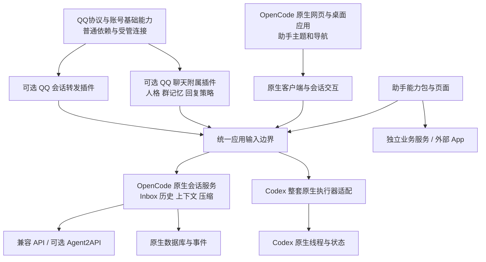

# 基于 OpenCode 的 IM-Assistant 二次开发方案

本方案替代“新建 Python 宿主，再接入 OpenCode 后端”的旧路线。主工程改为完整 OpenCode 应用：尽量保留其前端交互、客户端数据访问、服务、数据库、会话、Inbox、上下文、压缩、配置和桌面机制，在它上面裁剪编码功能、替换助手视觉，并逐项接回旧助手能力。

旧助手是能力探索、产品规则和缺陷经验库，不是新工程要整体移植的框架。旧源码留本地只读，原生产服务、任务、账号和数据继续由原系统拥有。本方案初稿交付时尚未导入源码或安装依赖；此后实施情况以进度记录为准，不能把初稿描述当作当前状态。生产入口尚未切换。

实施入口为 [接手指南](../handoff/接手指南.md)，[任务分解](../handoff/work-plan.json) 和 [进度记录](../handoff/progress.json) 共同定义当前工作。旧路线及已通过的 P0 证据保存在 [历史归档](../archive/python-host-plan/README.md)，不再驱动后续实施。

## 1 产品和技术方向

1. 以 OpenCode 应用为基座二次开发，不再先做一套自有会话壳、控制器和数据库，再嵌入 OpenCode。
2. 可用的原生功能整体复用，包括交互、历史读取、数据库规则、缓存、事件、执行、恢复、上下文和压缩；并不限于数据库或前端几个组件。
3. 移除项目文件树及项目文件操作能力。内部数据库、配置、日志、受控附件和后续业务文件处理仍可使用。
4. 保持助手已经确定的视觉和有限动效，但不搬入旧发送、排队和历史状态机。
5. 能力通过原生插件或有限产品补丁接回。缺少的业务能力才新增，不把原生已经提供的功能重写一遍。
6. Codex 的原生线程、账号、上下文和压缩仍需保留；它与普通 API 在应用的会话入口同级，不被塞进第二层模型工具循环。
7. QQ 是可选输入输出接口，不负责启动主程序，不拥有会话执行队列。
8. 整体保持“核心框架＋插件”：OpenCode是核心框架的基础，助手业务以插件接入，不演变为所有业务都写入核心的单体应用。

“全面采用”表示以整套原生应用作为默认实现来源，不表示未经验证就承诺所有上游功能都适合助手，或所有扩展需求都能零修改实现。

## 2 已核对的上游来源

官方仓库是 [anomalyco/opencode](https://github.com/anomalyco/opencode)。本次核对的开发分支快照为 `92b2ca0dd727942e00aba3523ed141d53e78ea28`；该快照 package.json 标示2.2.2、bun@1.4.4，桌面包使用 Electron、共享应用使用 Solid。它是源码调研证据，不是已选择的正式交付版本。

实施已选定并导入正式 v2.2.3 / `082ac6281fd395c2d0c17fd3c38214db2f89621f`，来源、锁文件与累计补丁见 [upstream/opencode.json](../../upstream/opencode.json) 和 [补丁台账](../../upstream/patches.json)。下表保留初稿源码调研的固定引用。

| 已核对的源码位置 | 对本方案的依据 |
| --- | --- |
| [开发说明](https://github.com/anomalyco/opencode/blob/92b2ca0dd727942e00aba3523ed141d53e78ea28/CONTRIBUTING.md) | 原生已有 core/server/client/app/desktop 等分工，应沿用，而不是在外面重新造一套 |
| [会话输入队列](https://github.com/anomalyco/opencode/blob/92b2ca0dd727942e00aba3523ed141d53e78ea28/packages/app/src/session/composer/queue.ts) | 前端已有入站队列交互，可直接作为改造来源 |
| [原生 Inbox](https://github.com/anomalyco/opencode/blob/92b2ca0dd727942e00aba3523ed141d53e78ea28/packages/core/src/session/inbox.ts) | 排队、引导和持久输入已有原生机制 |
| [原生历史读取](https://github.com/anomalyco/opencode/blob/92b2ca0dd727942e00aba3523ed141d53e78ea28/packages/core/src/session/history.ts) | 历史、压缩边界和原生上下文读取需要一起保留 |
| [桌面数据库](https://github.com/anomalyco/opencode/blob/92b2ca0dd727942e00aba3523ed141d53e78ea28/packages/desktop/src/main/storage/database.ts) | 桌面持久化也已有机制，无需另做相竞争的桌面状态库 |
| [Location](https://github.com/anomalyco/opencode/blob/92b2ca0dd727942e00aba3523ed141d53e78ea28/packages/core/src/location.ts) | 上游仍有目录/项目假设，去项目化需要兼容处理，不能只删文件树 |
| [默认工具](https://github.com/anomalyco/opencode/tree/92b2ca0dd727942e00aba3523ed141d53e78ea28/packages/core/src/tool/plugin) | 文件、补丁、shell 等能力需在工具和调用层实际裁剪 |

R0-01 选择正式源码 tag 与 commit、保留原锁文件并建立未改造基线。旧 SDK 2.1.4 只作历史经验，不再约束新应用必须使用它。版本选择不能混用 V1 文档、V2 SDK 和另一个版本的桌面源码。

## 3 目标结构



主程序启动、会话基础交互和原生存储都在 OpenCode 应用内。助手新增代码优先使用上游插件/GUI/RPC/命令等现有边界；不足时做有记录的产品补丁。不会再出现一个 Python 宿主认领任务、QQ 再认领一次、桌面又直接调用另一入口的结构。

重负载业务可以保持 Python 或独立服务，默认通过明确接口连接。Python 仍用于自动化、数据处理和适合它的业务，不强制将上游 TypeScript 核心改写成 Python。

### 固定的架构边界

| 层次 | 职责 | 不应承担的职责 |
| --- | --- | --- |
| 核心框架 | 基于OpenCode的应用生命周期、原生会话/数据机制、基础界面及插件公共入口 | QQ专用规则、研究分类、设备业务、找源策略等具体业务派发 |
| 能力插件 | QQ转发、Codex整套原生适配、研究、下载、设备、聊天机器人等完整能力；可带自己的页面和后端 | 接管全局发送/队列，私读其他插件数据，偷偷改变核心会话所有权 |
| 公共接口与展示位置 | 为插件提供明确的调用、状态、配置、消息和UI接入位置，优先使用原生扩展机制 | 为每个插件复制一个核心入口，或另建通用Python宿主 |
| 依赖与运行时 | 原生工具链、SDK、驱动及能力所需的库/服务 | 被伪装为功能插件，向用户展示无意义的模块状态或造成全局启动捆绑 |

插件按完整能力组织，不为一个功能拆出大量必装小插件，也不要求所有插件都另起进程。重负载或需要故障隔离的能力可独立服务；依赖须明确声明，通过公共接口访问，不导入别的插件私有实现。无QQ或无某业务插件时，核心及无关插件应继续工作。

持有长期连接的完整能力可通过可信ApplicationModule取得应用级资源生命周期、公共原生客户端和按插件ID隔离的原生KV；同步交回可关闭资源，异步连接和登录不得阻塞核心。ServerProcess/ServerFetch在同一应用Scope安装一次，并在释放客户端/数据库前关闭入口；不得借每Location的插件setup重复登录。它不是另一个宿主或会话后端；整套会话系统仍使用ConversationBackend契约。产品层只装配编译期明确的能力，JSON、HTTP和模型消息不能贡献任意代码。状态页面、动态模块市场和其他业务能力按后续阶段接入，不因此宣称已完成。

这个边界是后续二次开发的约束，不以修复某个问题为由临时改变。每次改动都要说明：属于核心、插件还是依赖；复用了哪个原生入口；是否改变状态/队列/数据所有者；是否引入反向依赖或全局接管。与既定边界冲突时先解决架构归属，不能以“兼容补丁”默默恢复旧结构。

QQ会话转发与QQ聊天机器人是两个独立可选业务插件。小羊等聊天机器人作为QQ附属插件接入，复用协议能力，不作为转发插件内的“人格模式”。账号、配置、记忆、工具权限、启停和回执映射分别隔离；协议复用属于依赖，不再造宿主。具体分工及迁入验收见[QQ接入与附属机器人边界](QQ接入与附属机器人边界.md)。

## 4 复用、裁剪和新增清单

| 领域 | 默认处理 |
| --- | --- |
| 桌面壳、窗口、启动、原生设置 | 复用对应 OpenCode 应用实现；调整品牌、数据路径和助手入口 |
| 会话列表、输入、发送、接收、草稿 | 复用原生交互与数据访问，换样式，不复制旧控制器 |
| Inbox、引导、排队、撤回、执行恢复 | 复用原生机制；确有产品缺口才最小修改 |
| 历史、数据库查询、分页、事件和缓存 | 使用原生存储/查询/订阅，不在助手服务里另写同步系统 |
| 上下文、压缩、工具循环、模型连接 | 复用原生核心，按助手权限裁剪工具 |
| 用量、模型目录和凭据 | 优先原生；补充今天/7天/累计等已确认的展示口径 |
| 项目文件、编辑、diff、终端、Git/worktree操作 | 从助手产品及默认能力中移除 |
| 助手导航、总览、系统消息、模块展示 | 能用原生扩展就用；只为原生没有的助手需求新增 |
| QQ、米家、研究、下载和外部播放器 | 依据旧助手能力经验逐项接回，不能成为主程序启动依赖 |

不能因为某个旧模块有现成页面，就连同它私有的发送队列、账号池、全局轮询和启动顺序一起搬入新应用。

## 5 文件系统移除的准确范围

用户已经确认：移除项目文件树和文件操作能力，不是仅隐藏文件浏览界面。

移除项目选择作为日常入口、目录树、文件搜索和编辑器、diff/patch、通用终端、Git/worktree 等编码界面。模型侧移除任意项目文件读取、写入、编辑、glob/grep、补丁及可绕过限制的通用 shell/脚本工具；直接 API、命令面板、MCP 和子代理路径也须覆盖。不能改名为另一工具后继续提供同一能力。

保留应用内部数据库、配置、日志、迁移、缓存和受控附件存储。用户主动上传/粘贴的附件、受限导入导出及未来下载服务可经专门接口处理；不提供任意磁盘路径、任意代码执行或目录扫描。下载器写自己的目标位置不等于向模型开放整个文件系统。

上游内部可能仍需 Location/目录标识。先用应用管理的非项目环境满足必要前提，停止 Git 探测、项目指令读取、文件监视及项目级自动工具加载；不指向真实工作区，不为删目录概念重写全部原生存储。若某依赖无法去除，记录最小兼容层和测试，而不是全局删除内部 filesystem 包。

此策略针对助手产品提供的能力。外部既有 Codex 独立应用不被修改，但助手入口不能借 Codex 转发绕过本策略；原生执行器适配的可行性必须单独验证。

## 6 会话和排队的唯一来源

普通 API 会话由 OpenCode 原生 Session/Inbox 拥有执行权；前端只使用其已有交互和真实数据，QQ 也提交到同一输入边界。客户端中的乐观展示仍按原生实现管理，不能由助手再增加一套抢占、认领和执行队列。

收到输入、持久接纳、开始执行、实际应用、结果完成与通知发送仍是不同事实。保留这些产品语义，但先适配原生事实，不把旧版自定义 JSON-RPC 和18项 Python宿主任务作为 OpenCode 的强制外层。

原生本身若存在缺陷，先在原版隔离样本复现，再做最小补丁并保留前后回归。不得以“上游已有”代替实际验证，也不得借修补需求重写完整状态机。

## 7 数据库和历史读取

OpenCode 原生数据层管理会话、消息、Inbox、执行、事件和上下文，包括它们的索引、查询、事务及迁移。前端经原生客户端访问；没有网页直接查询 SQLite、Python 控制层猜读原生表、两套历史库互相同步的链路。

助手扩展只保存自身拥有的数据，例如 QQ 身份/绑定/消息映射/发送记录、模块配置、通知已读和业务索引。优先使用原生扩展存储；确需自己的业务数据库时有独立命名空间、明确所有者和迁移，不增加第二份模型上下文或权威执行队列。

历史分页、首显、滚动锚点、消息归属、流式版本和缓存失效先沿用原生规则。最近10条首显是原产品体验目标：若原生有更好的按需加载方案，先实测并记录兼容选择，不机械地重造10条缓存来覆盖原生机制。

原生数据库迁移不能当成旧助手数据库导入。历史资料和研究经验需要后续专门的受限导入器，保留来源和去重；不直接复制旧库、账号目录或浏览器状态。

## 8 Codex 同级原生执行器

保留原生线程、账号、工具循环、上下文和压缩的目标不变。它是整套原生会话执行器，不是一个无状态模型，也不通过 OpenCode 再调用一轮模型来控制 Codex。

应用级可为会话标识所属执行器，保存原生身份映射和只读展示投影。原生 Codex 历史及压缩不强行转换成 OpenCode 的模型上下文。执行队列在每条会话中只有一个权威所有者；若桥接需要 Inbox，只承担可靠移交，不重复认领和调度。

这是需要验证的产品适配点，不是已经存在的通用插件保证。R0 先核查可接入边界，R3-01 做最小闭环；必要时增加小范围执行器选择边界，不能恢复原计划中的独立多后端 Python宿主。无法证明原生身份、队列和权限正确时，不发布对应入口，也不假称兼容完成。

## 9 QQ 薄转发

QQ 只负责账号连接、外部身份和授权、会话绑定、引用关系、附件、输入转交及结果通知。主应用、所有能力状态和普通会话都不能等待 QQ 登录。

保持当前实际有效的规则：私聊/群聊身份范围、白名单和@条件、任务起始消息引用、历史留言去重、排队消息撤回及提示撤回等在接回前逐项盘点。不能把历史上已被取消的要求重新当作现行规则。

引用路由识别新输入、当前调整或队列补充后，调用同一原生输入能力；不维护第二个执行调度器。通知发送具有独立重试与核对记录，失败不重跑已完成任务，也不阻塞下一输入执行。小羊由独立QQ聊天附属插件负责，保持独立账号、上下文、权限和回复规则，不自动套用任务助手路由；聊天业务迁入不是转发插件的启动或验收前置。

## 10 助手能力的接回方式

优先使用上游现有插件的服务端、GUI和RPC边界；需要主程序级改造时统一记为产品补丁，避免多个业务包接管全局发送、窗口或数据库函数。GUI扩展接口在已核对文档中仍带 experimental 名称，故不能假设永远稳定或足够实现全部页面。

新增核心代码仅用于通用框架能力或产品级策略；具体业务归插件。插件需要新位置时，在核心补公共入口再接入，不能让核心按QQ、研究或设备等具体插件名称分支。Codex适配也作为完整插件使用应用提供的执行器边界，不成为另一套核心框架。

整个能力包可在 `modules/<module-id>/` 维护，不把一个完整模块切成一堆必装小扩展。重负载能力可以是独立进程或外部 App，主程序只持有其接口与状态；其失败不应关闭会话内核。

后续模块阶段依旧在基座验收后执行，不因改用 OpenCode 就同时迁完所有业务。新基座要先有适当位置，业务按真实使用价值逐项加入。

## 11 旧助手经验的沉淀格式

每项候选能力建立一条清单：用户目的、当前有效规则、旧源码只读参考、已知缺陷及重现步骤、OpenCode 原生替代点、需要接回的最小差异、数据归属、权限、依赖、验收与回退。先判断复用/替代/淘汰，再写代码。

| 能力或经验 | 接回方向 |
| --- | --- |
| 历次发送、排队、引导、撤回和顺序问题 | 作为原生交互回归样本，不保留旧状态机 |
| 全局模型/账号、用量和上下文 | 优先原生能力，按实际上游限制适配，不伪造 Token 或上下文容量 |
| 研究协助与执行、可复用路线 | 后续研究能力包；保留决策/采集分工，不将研究路径塞入会话内核 |
| 浏览器、验证码和已登录窗口 | 后续受限工具能力；遇验证停留并请求人工，不后台反复刷新 |
| 米家、传感器、性能和总览 | 独立按需服务及轻量页面，不持续全局轮询 |
| 下载、影视节目单、音乐反馈 | 按业务接口接回；影院和音乐播放器可继续作为独立 App |
| 小羊人格、群记忆、图片和表情 | 可选QQ聊天附属插件，独立于qq-portal；账号、记忆、权限、启停和回执均隔离 |

清单只先提取代码与合成样本。真实历史、研究资料和登录态的迁移另行设计，不上传旧客户端源码或私人运行数据到公共仓库。

## 12 源码目录和上游维护

```text
opencode/              未来导入锁定上游源码，保持原目录及原锁文件
  packages/app/        原生共享网页应用，助手主题及有限布局补丁
  packages/desktop/    原生桌面壳与桌面持久化
  packages/core/       原生会话/Inbox/历史/数据库/执行
  packages/im-assistant/  本产品新增配置、策略与装配位置（拟新增）
modules/               QQ、Codex原生适配及后续完整能力包
upstream/              基线与补丁台账，R0-01创建
tests/rebase/          本产品行为验收入口，驱动原生测试及真实应用
docs/                  当前方案、接手、验收和旧路线归档
sdk/ host/ conversation/ portal_adapter/
                       现有旧路线参考代码/预留目录，不继续建设为新基座
```

上游按源码快照导入 `opencode/`，保留 monorepo 依赖关系、锁文件、LICENSE 与版权。`upstream/opencode.json` 记录 tag、commit、完整性与工具链；`upstream/patches.json` 记录每项产品补丁的目的、文件和测试。不要散拷几个文件后丢失来源，也不自动拉最新版本覆盖产品修改。

现有仓库继续作为 IM-Assistant 公共工程；不上传旧客户端，不把现有 P0 参考代码伪装成已经迁入的 OpenCode 应用。整体项目许可选择另记，上游许可证和归属必须保留。

## 13 分阶段实施

| 顺序 | 工作 | 完成判据 |
| --- | --- | --- |
| R0 | 正式源码基线和未改造应用 | 锁定来源；原生应用能独立构建/启动；核心交互有原版证据 |
| R1 | 助手模式、数据隔离及文件能力裁剪 | 无项目也可用；禁用真实生效；内部存储与附件仍正常 |
| R2 | 原生会话闭环、API与用量 | 旧交互缺陷有回归；使用原生机制，未新增竞争状态机 |
| R3 | Codex整执行器与QQ薄转发 | 原生身份/队列保持；所有渠道走同一应用边界，QQ可缺失 |
| R4 | 公共能力位置与助手换肤 | 原生扩展优先；界面按原生逻辑运行，能力按需加载 |
| R5 | 故障、性能和迁移候选版 | [36项验收](实施与验收.md)有证据，具备安全迁移与回退方案 |
| 后续业务阶段 | 研究、下载、设备、播放器等逐项接回 | 每项有明确增益和独立验收，不整体搬旧系统 |

详细10个实施任务及依赖在 work-plan.json。当前它们全部待开始；文档重写不能算原生基线已构建，更不能把旧 P0 的49项测试转为这10项完成。

## 14 验证原则

先在未改造原版记录会话、排队、历史和重启基线，再在同一锁定版本验证产品补丁；区分上游缺陷、助手改动和外部连接问题。优先保留原生单元、集成和桌面测试，本产品测试补足旧缺陷与权限边界。

Python 验收脚本可以编排原生 Bun/TypeScript 测试与应用启动，但不能用几个静态断言冒充前端已工作。网页、真实浏览器、Windows桌面分别给出结果，空测试、缺入口或跳过必需测试都不能通过。

特别覆盖：忙闲切换、输入立即可见、最后结果先于下一项、会话切换不停任务、历史位置不跳、数据顺序、消息归属、排队撤回、重启去重、QQ离线、模块失败及文件禁用绕行。性能比较使用相同样本，监控按需启动。

## 15 迁移和回退

原生产系统不自动停用。先在隔离数据、端口和测试会话运行候选版；原账号、浏览器和运行任务不被新应用领取。已运行任务由原执行器完成，新任务才按明确切换进入新应用。

会话迁移记录来源、目标、原生身份和唯一接纳所有者。历史材料按公开导出/受限导入处理，不把消息导入描述成原生上下文的无损转移。模型/账号切换范围以真实上游行为核对。

回退不能把新应用已接纳输入重新投到旧队列，不能用旧库覆盖新库。代码回退与数据迁移独立记录。正式启动入口、自启、旧记录删除和生产切换必须在对应迁移步骤明确执行，本轮不执行。

## 16 当前交付和下一步

已完成：路线重写、旧计划归档、源码结构核对、10项任务和36项验收、接手工具调整。既有 P0 代码和49项测试保留为参考，原客户端源码仍仅本地保存。

未完成：正式源码版本选择、源码导入、原生构建与运行、文件能力裁剪、换肤以及各能力接回。下一项是 R0-01，不是旧计划的 P1-01。任何接手 AI 都应先核对当前 plan_id，再执行 next_task.py，避免复活已归档的 Python宿主路线。
