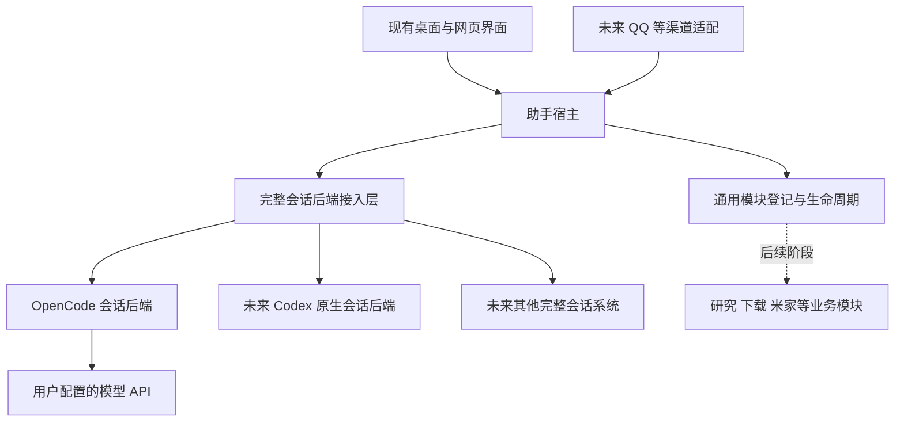

# 助手宿主与整套会话后端接入方案

日期：2026年10月30日。范围：宿主地基、整套会话后端接入契约和参考实现。业务模块重组、旧数据迁移及正式切换属于后续工作。

本次建设一个能够承载完整会话系统的助手宿主。OpenCode 作为默认参考后端；Codex 原生会话系统及其适配代码作为另一种同级后端。后端自行拥有会话历史、原生上下文、压缩、工具循环和内部队列，宿主提供统一入口、身份与绑定、事件展示、连接管理和生命周期管理。

上下文、压缩器、工具循环不需要分别安装、注册或拼装。接入方交付一个完整后端，通过一份描述、一组边界接口和一条事件流接入。后端内部可以继续使用原版系统的数据格式、调度和压缩机制。

## 1 本轮需要形成的地基

| 必须完成 | 本阶段交付内容 |
| --- | --- |
| 独立宿主 | 无 QQ、无业务模块、无模型连接时仍能启动，显示配置、后端目录和明确空态 |
| 通用生命周期 | 发现、安装登记、启动、停止、更新、运行状态与独立故障处理 |
| 完整会话后端契约 | 统一会话列表、历史读取、输入提交、接纳回执、事件和恢复查询 |
| 输入与输出基础 | 桌面输入入口、身份与附件引用、请求幂等、结果通知与发送账本 |
| 默认参考后端 | 基于已锁定 OpenCode SDK 的完整后端，用普通兼容 API 运行一条最小会话闭环 |
| 原生后端接入样例 | 使用测试后端验证原生历史、队列、工具和压缩完全留在后端内；不要求现在迁移 Codex |
| 现有客户端适配面 | 保留现有视觉，先让会话页通过新门面运行；状态均来自后端回执 |
| 契约验证 | 不依赖真实模型、QQ 或业务模块即可运行的后端接入测试套件 |

本阶段不改研究、下载、米家、传感器、小羊、影视、音乐等业务实现，不重排它们的数据，也不把现有运行任务迁到新宿主。模块市场先有包格式、登记和安装边界；在线 GitHub 市场、下载及升级策略后续接入。

“完整方案”指本阶段设计、实现顺序和验收闭合，并不要求这一轮将所有未来模块的功能接口都设计完。

## 2 本轮已经确定的架构决策

1. 宿主拥有应用生命周期，会话后端拥有完整会话行为。
2. 会话后端是接入单位，压缩、上下文和工具不是独立必装扩展。
3. OpenCode 与 Codex 后端在接入层同级，不把 Codex 原生任务套进 OpenCode 的模型工具循环。
4. 普通 API 通过 OpenCode 后端使用；Agent2API 是可选 API 地址，不是宿主或所有会话的硬依赖。
5. 一个会话的执行顺序只有一个权威所有者，由该会话后端负责。宿主不再维护竞争的执行队列。
6. 宿主的接收账本、后端执行队列、渠道发送账本分别表达投递、执行和交付，不互相冒充。
7. 核心不导入业务模块实现，不按具体模块 ID 分支调度。
8. 新旧系统切换以会话为边界，运行中的会话不跨后端、账号或版本搬迁。

第5项会改变旧控制层的职责。本阶段只在隔离的新地基中实现；旧生产队列继续由原所有者运行，后续按会话切换所有权，不能同时启用两套调度。

## 3 目标结构



宿主使用 Python 延续现有应用运行方式；OpenCode 参考后端继续在自己拥有的 Node 进程中嵌入 SDK。外部会话系统可以保持自己的语言和运行环境。客户端访问宿主，不访问各后端私有数据库和任意原生端点。

这里的会话接入层是接口适配和路由，不生成回答，不运行另一套 Agent 循环，也不以等待模型响应来阻塞应用启动。

## 4 宿主负责什么

| 范围 | 宿主责任 | 边界 |
| --- | --- | --- |
| 应用 | 窗口与后台连接、单实例、启动退出、公共本机接口 | 不依赖 QQ 或某个模型登录成功 |
| 模块 | 静态发现、版本兼容、进程所有权、配置入口、运行状态 | 发现阶段不导入并执行模块代码 |
| 身份 | 本机用户、外部主体映射、来源授权、会话访问与绑定 | 不以 QQ 号代替所有用户身份 |
| 输入 | 保存原输入身份、请求 ID、附件引用、冻结的目标后端与会话 | 不根据“当前最新绑定”转移已经接收的输入 |
| 投递 | 可靠转交、结果查询、异常核对 | 不决定后端内部下一条任务何时执行 |
| 展示 | 聚合列表、分页历史、增量事件、能力对应的按钮、用量投影 | 不伪造已读、压缩或完成状态 |
| 通知 | 系统消息、未读、订阅、对各渠道的独立发送回执 | 不因通知失败重跑后端任务 |
| 数据基础 | 自己的配置、目录、绑定、投递账本、缓存与版本迁移 | 不越过后端公开接口修改原生历史 |

后端扩展需要的未来展示和数据接入，在通用声明中预留 `contributions` 与有版本的命名空间。只有实际引入对应宿主能力时才承诺支持，未知扩展不得直接执行。此处不提前设计几十个互相独立的插件槽位。

## 5 整套会话后端负责什么

一个后端包可以包含自身连接器、持久化、上下文、人格与记忆、工具循环、压缩、队列、账号及原生进程适配。内部实现不要求与宿主同构。

接入时只暴露三个层面的信息：

| 层面 | 内容 |
| --- | --- |
| 后端实例 | 身份、版本、健康、运行方式、配置、原生实例归属 |
| 会话与输入 | 列表、新建、历史、提交、请求核对、事件 |
| 可选操作 | 排队管理、调整、撤回、取消、上下文查看、手动压缩、用量、权限交互等支持声明 |

能力声明只控制宿主可以向后端请求什么，不是实际实现成功的证明。必须通过对应契约测试后启用按钮。

后端的内部队列如果原生支持，就使用原生队列；若原生系统缺少必需的入站排序能力，由这个完整后端包内部提供适配。原生队列与适配层之间也必须明确唯一权威状态，不能把同一个输入重复排到两处。

### 原生机制的位置

| 机制 | 后端如何保留 | 宿主如何使用 |
| --- | --- | --- |
| 原生上下文 | 保存自身 session、thread 和上下文引用 | 只保存不透明引用及可公开的摘要指标 |
| 压缩 | 自行触发、总结、保留上下文及记录压缩结果 | 展示事件；支持时可调用整套后端的压缩操作 |
| 工具 | 使用后端原生工具循环及权限机制 | 展示公开工具活动；不复制或重跑工具 |
| 历史 | 原生消息与附件由后端管理 | 经游标分页读取，允许可重建的展示缓存 |
| 队列 | 自行排序、认领、排队撤回及启动 | 转发队列操作并展示权威快照 |
| 恢复 | 查询原生请求和实际副作用 | 通过原请求 ID 查询，保持结果未知状态 |

未来某后端的上下文或压缩机制与 OpenCode 不同，不需要改宿主，只需完整后端按契约返回引用、能力和事件。

## 6 OpenCode 参考后端

本机已经安装 `@opencode/sdk`、`@opencode/plugin` 2.1.4，现有 `service.mjs` 使用 `OpenCode.create()`，并调用原生会话、Inbox、事件和压缩。参考实现以这组已锁定包和完整性信息为起点，不在重构时同时进行无约束的上游升级。

官方 V2 文档说明 SDK 支持在应用中嵌入宿主、创建和输入会话、订阅事件，并通过插件定制行为。[OpenCode V2 SDK](https://opencode.ai/v2/docs/build/sdk/)

官方 V2 插件体系允许一个包组合服务端和客户端部分并声明 RPC 接口，可作为完整包接入的参考；我们保留现有助手界面，先不依赖其仍带实验标记的 GUI 扩展。[OpenCode V2 插件](https://opencode.ai/v2/docs/build/plugins/)

V1 的 `@opencode-ai/sdk` 文档不能直接作为当前 `@opencode/sdk` 2.1.4 的方法签名依据。实现时以锁定包类型和本地接入测试为准，适配器可以升级，宿主协议不跟随每次上游改名。

参考后端需要完成的具体收口：

- 将当前 Python 桥中对 `agent2api/model_info` 与 `model_proxy` 的硬编码替换为本后端选定的 API 连接。
- API 地址、密钥引用、模型及额外参数由 OpenCode 后端的配置管理，密钥保存在宿主安全存储或后端自己的安全存储中。
- 后端内部保持一套会话、Inbox、工具循环、压缩及恢复机制；宿主不组装第二份模型上下文。
- 将现有 `/run`、`/steer`、`/withdraw` 等专用接口封装成统一后端接口，保留原生身份核对。
- 关闭默认编码工具或项目扫描等不适合个人助手的能力，按本后端明确配置提供工具；接入 SDK 不自动授予文件和终端权限。
- 上游文档不保证每个模型的真实上下文容量。限额来自选定模型的配置或实际元数据，未知时不显示虚假的占用百分比。

OpenCode 后端停止时，宿主仍能展示列表缓存、配置与通知；未来 Codex 后端不因 OpenCode 故障一起停止。

## 7 普通 API 与 Codex 的同级接入

用户界面统一展示“会话连接”，连接由所属后端发布。每个选项都可以新建或关联会话，不需要在前端分别编写 API 和 Codex 的发送分支。

| 用户选择 | 完整会话后端 | 内部生成与执行 |
| --- | --- | --- |
| 某个兼容 API 连接 | OpenCode 后端 | OpenCode 使用该 API 完成会话循环 |
| 本机 Agent2API | OpenCode 后端 | 通过普通 HTTP API 使用网关 |
| Codex 账号连接 | 未来 Codex 后端 | 原生 Codex 会话与原生执行 |
| 其他远端助手系统 | 未来对应后端 | 对方整套会话系统 |

API、Codex 在宿主选择与调用层同级，不要求协议、数据格式和原生功能相同。Codex 不需要伪装成无状态的 `/chat/completions`，也不需要接受 OpenCode 的压缩结果作为自己的原生上下文。

同一会话固定所属后端。更换后端时显式创建关联新会话；可以通过公开导出导入带入资料，但不把公开历史搬运描述成原生线程或压缩状态的无损迁移。更换同一后端内的模型按后端支持的模型切换操作执行。

全局账号选择影响之后接收的输入；已接收输入冻结账号和配置版本。切换界面、绑定或全局默认值不会暂停、转移或重放旧输入。

## 8 统一入口与投递状态

宿主为每个输入生成稳定 `request_id`，保存授权主体、外部消息来源、目标会话、附件和配置修订。后端收到同一 ID 的重试时应返回同一接纳结果，不能新建第二次执行；改变正文后重复使用同一 ID 必须冲突。

宿主投递账本只包含：

```text
received → transferring → accepted
                    ↘ unknown → accepted / rejected / needs_reconciliation
                    ↘ rejected
```

`accepted` 只表示后端持久接收，不表示已经执行或模型已经读取。`unknown` 不能显示为已排队成功，不能因 HTTP 超时重新生成 ID 提交。

后端负责返回自己的执行状态，例如：

```text
queued → starting → running → completed
                    ↕ waiting_input / waiting_resource
running → pausing → paused → queued
queued → cancelled
running → cancelling → cancelled
异常或中断 → failed / recovery_check
```

后端不支持的状态和操作不强行补齐；保留可读的原生状态以及公共显示映射。任何终止、调整、撤回命令都绑定具体原生输入或执行身份，不操作“当前最新任务”。

宿主可以为了网络断开暂存尚未转交的输入，但显示为“待发送”。是否自动恢复转交取决于是否已明确证明后端未接纳；无法证明时先核对，不把暂存扩展为另一套业务执行队列。

## 9 排队与消息体验

排队快照由后端发布，包含版本、运行项、等待项及可用操作。桌面和未来 QQ 都向同一会话后端提交，不各自认领执行。

| 场景 | 目标行为 |
| --- | --- |
| 空闲发送 | 后端按原生规则立即接纳启动，不先伪造排队再撤回气泡 |
| 忙碌发送新任务 | 后端返回排队项，界面立即显示该回执，不等待前一条 AI 回复 |
| 引导或调整 | 按后端能力提交到精确任务，区分已收到与已应用 |
| 前项结束 | 先持久化最终结果及顺序事件，再发布结束并启动下一项 |
| 通知还未发出 | 不阻塞后端下一项启动；结果已能从原会话读取 |
| 切换界面 | 只切换订阅和渲染，运行及队列保持 |
| 调序或排队撤回 | 后端按预期队列版本处理，失败则重新读取真实状态 |
| 后端未提供撤回能力 | 隐藏按钮或明确不支持，不能通过停止当前运行冒充撤回 |

“前项结果先提交”保证事件顺序；“不等 QQ 发送成功才启动下一项”保证业务与通知解耦。客户端按事件顺序渲染，不以异步历史请求完成的时间决定消息顺序。

QQ 的原消息撤回仅取消尚未执行的排队任务，成功后按实际消息 ID 撤回对应排队提示；执行中的任务保持既有规则。此项作为未来渠道兼容验收，不在本阶段重写 QQ 机器人。

## 10 会话列表与历史

宿主统一会话 ID 映射到后端实例、原生会话 ID 和访问范围。列表聚合结果允许缓存；一个后端离线时，它的会话显示离线状态，不拖慢其他后端列表。

后端是原生历史的权威来源。宿主可以持久缓存公开消息以加快展示，但缓存不驱动模型上下文、执行状态或后台恢复，不独立决定某消息已经完成。

历史接口必须支持稳定游标和尾部读取。初次激活优先使用最近10条公开消息缓存，再按后端游标更新。向前加载保留消息锚点与容器内偏移，不跳到新加载列表顶部。

公开消息包含稳定 ID、所属输入/运行、角色、内容片段、附件、顺序、更新时间和完成状态。流式回答的增量更新同一个消息，不按每个片段新建消息。已发送未回复的用户消息归到自己的输入和运行，不能挂到前一条 AI 最终结果下。

历史消息不重新播放弹入动效。新消息按稳定 ID 仅展示一次动效；缓存、重新订阅和前翻不能改变这一事实。后端没有稳定历史 ID 或游标时，接入测试不通过，不能通过时间排序猜测归属。

## 11 事件与恢复

每个后端实例提供有顺序、可断点续读的事件流。宿主保存来源游标，并为前端分配自己的聚合序号；聚合序号不改变来源事件的执行先后关系。

事件至少关联后端实例、后端实例世代、原生会话及适用的输入或运行 ID。重启实例改变世代，但不得导致持久事件身份重复；适配器需要提供持久事件 ID 或稳定的去重依据。

输入接纳、队列变化、运行开始、消息更新、结果、结束、用量、人工等待和错误都通过同一后端边界输出。宿主不把私有思维链、原生内部提示或凭据复制到公开日志。

| 中断位置 | 恢复方式 |
| --- | --- |
| 宿主保存输入后、转交前 | 对照投递记录与后端查询确认后再转交 |
| 请求发出后、接纳回执前 | 标记结果未知，使用原 ID 查询，不盲目重发 |
| 后端已接纳、宿主未存回执 | 读取原接纳结果和来源事件，补全映射 |
| 执行器崩溃 | 后端核对原生运行与外部操作，宿主展示其恢复状态 |
| 最终结果已产出、通知前 | 补收结果并独立恢复通知发送 |
| 渠道发送成功、回执丢失 | 保留发送结果未知，渠道核对实际消息；不能保证的平台不宣称恰好一次 |
| 来源事件保留期已过 | 读取带一致性水位的状态快照和历史分页，重建展示缓存 |

本地状态使用事务去重；外部系统不提供幂等或查询时，明确保留核对状态。新宿主不承诺跨任意外部系统的绝对恰好一次执行。

## 12 运行隔离与生命周期

宿主内仅运行可信、轻量且有时限的通用代码。完整会话后端默认独立进程或受认证的外部服务。进程隔离用于限制故障传播和归属资源，不等于对同一 Windows 用户下任意插件代码提供安全沙盒。

静态清单发现完成后，宿主按需要启动后端。后端初始化失败只让对应实例不可用；客户端先打开，不等待模型网关、浏览器、QQ 或后端原生进程就绪。

维护顺序：将目标实例设为 `draining`，停止它的新接纳，等待其真实在途执行完成，保存游标与回执，再停止或更换版本。未开始的后端排队项由后端持久保存，不能因为存在排队记录就永远无法维护。是否支持带队列更新须由后端声明并验证。

不支持安全排空或队列持久恢复的后端返回具体阻塞原因，等待用户处置；宿主不强杀来模拟“平滑升级”。不同后端和无依赖模块继续工作。

子进程记录 PID、创建时间和实例身份，只关闭自己拥有的进程。外部已存在的服务由连接器使用，不因断开或卸载连接器而自动关闭。

## 13 数据与配置归属

| 数据 | 权威所有者 | 宿主保存内容 |
| --- | --- | --- |
| 模块安装与实例 | 宿主 | 包版本、入口、状态及数据版本 |
| 本机身份、渠道主体与访问关系 | 宿主 | 身份映射和授权记录 |
| 会话归属与连接目录 | 后端发布，宿主登记映射 | 后端引用、标题缓存和可见性 |
| 输入投递 | 宿主 | request ID、冻结目标、转交与核对结果 |
| 任务执行与排队 | 完整会话后端 | 可重建的快照与公开事件投影 |
| 原生上下文、压缩与工具状态 | 完整会话后端 | 不透明引用及公开指标 |
| 历史正文与附件 | 后端或其附件存储 | 可重建展示缓存和受限附件引用 |
| 渠道绑定、消息归属及发送 | 宿主与所属渠道适配的公开契约 | 绑定版本、原消息和实际输出消息 ID |
| 用量 | 后端提供，宿主归一化记录 | 原始口径、来源和去重身份 |
| 业务资料与播放器断点 | 后续对应模块或外部应用 | 本阶段不迁移 |

新地基使用自己目录下的 SQLite 保存宿主数据，单写入服务、短事务和 WAL。高频 Token 流允许合并写入；接纳、最终结果引用与通知待发记录等关键边界持久化。大附件存文件，通过资源引用访问，不把任意本地路径交给网页或其他扩展。

配置分为宿主设置、后端实例设置、后端自己的连接设置。配置提交带预期修订号，后端校验并通过实际消费者回读，返回 `live`、`next_input` 或 `restart_required` 生效范围。已接收输入固定配置修订。

密钥不进入清单、事件和展示缓存。宿主提供安全凭据引用，使用现有 Windows 用户级加密方式；后端可以保留自己的原生账号管理，通过公开登录操作接入。通用配置不代管或搬运所有原生账号文件。

## 14 用量与性能基础

会话后端可发布请求级真实用量，记录输入、输出、缓存读取及缓存写入口径，并保留来源。后端未返回时显示未报告；字符估算如启用，必须单独标为估算，不混入实测总量。

上下文当前占用、套餐额度和累计 Token 是三个不同指标。套餐账号默认只统计用量，不凭 Token 推导真实费用；支持按 Token 计价的 API 可以按明确的价格版本估算费用。

今天、最近7天和累计采用 Asia/Shanghai 的统计边界。研究协助与研究执行的比例，依据后续任务来源和父子关系记录；子项已计入总量时不再叠加父项汇总。缓存命中百分比只在分子分母含义一致时计算。

宿主仅常态记录轻量调用耗时、错误和事件积压，不持续扫描机器进程。CPU、内存和硬件传感器采样由未来性能模块按需开启；页面关闭即释放需求。独立后端按自有进程实测，共享进程明确标共享，不虚构每个模块的独占内存。

## 15 前端接入范围

现有导航、会话列表、研究视图、颜色和消息样式保留。新增地基优先替换会话页的数据访问与事件控制器，不借本轮重构重做全部 UI。

| 页面 | 本阶段处理 |
| --- | --- |
| 总览 | 连接宿主基础状态和后端健康；业务卡片保持旧系统，后续迁移 |
| 消息 | 使用系统通知记录，未读与待处理分开，读完清除未读红点 |
| 模块 | 展示实例、真实状态、配置与维护结果；复杂市场后续接入 |
| 会话 | 统一后端列表、连接选择、分页历史、流式消息、能力对应的队列操作 |
| 系统配置 | 本机身份、后端目录、启动设置和凭据引用 |

后端可以声明自己需要的设置表单、可选上下文信息和操作动作。壳提供整套后端的展示面，复杂定制以后使用有版本的隔离视图。当前不允许后端注入脚本覆盖前端全局发送函数。

## 16 为未来模块保留的位置

本阶段完成通用包清单、实例生命周期、依赖声明、运行连接和公开命名空间。业务模块以后可以作为完整包接入，不必先拆成许多小插件。

研究、下载等模块未来需要的展示、动作、数据目录和消息发布，都从同一模块实例及其公开契约扩展。新增能力版本在注册时协商；宿主不认识的可选能力不加载，不因缺少可选依赖阻断应用启动。

未来研究模块向会话后端提交研究输入，使用自身流程与领域规则；后端继续提供原生上下文和工具循环。研究业务的目标、分支、质量门槛属于研究模块，不进入宿主会话协议。

影院与 Folia 作为外部 App 维护，未来通过应用连接器交换节目单和反馈。现有 Kodi 资料归属、下载模块找源职责等问题列入后续迁移，不混入本阶段的基础代码。

## 17 目录与通信方式

建议新实现先放入隔离的 `next/` 目录，不覆盖现有 `assistant_runtime/`、插件和运行数据：

```text
next/
  host/                 应用启动 生命周期 身份 配置 输入账本 事件与通知
  conversation/         后端目录 会话映射 消息展示与后端客户端
  sdk/                  清单 契约 类型及接入测试工具
  modules/              完整后端与未来业务模块统一放置
    opencode/           后续完整参考后端 含原生 SDK 与 API 连接
  tests/
    backend_fixtures/   只供测试的完整后端 不参与正式模块发现
  portal_adapter/       对现有前端的兼容门面
  runtime/              新地基自有数据与缓存 不提交到公共仓库
```

UI 到宿主沿用受认证本机 HTTP 和增量事件连接。宿主到子进程使用一条持久、双向的 JSON 协议连接；V1 参考实现优先 stdio JSON-RPC 2.0，普通日志走 stderr，不能污染协议输出。原生系统的 HTTP、管道或 SDK 连接封装在完整后端内部。

将来外部后端使用受认证 loopback HTTP 时保持相同业务契约，不另建一套消息状态语义。协议规定长度、超时、取消和背压；输出过快时合并可覆盖的文本增量，但不能丢掉接纳、结果和结束事件。已经进入持久事件流的事件不重写 ID 或序号。

## 18 建设顺序

| 阶段 | 交付 | 通过条件 |
| --- | --- | --- |
| P0 契约与边界 | 本方案、版本化契约、完整测试后端与接入测试工具 | 两套内部结构不同的测试后端均可通过相同门面运行 |
| P1 独立宿主 | 启动、模块登记、身份、配置、投递账本、事件与通知 | 无业务模块、QQ、模型时可正常打开，单后端故障不阻断其他后端 |
| P2 OpenCode 参考接入 | 一套完整会话后端，普通兼容 API 配置 | 会话创建、输入、真实接纳、工具闭环、压缩、历史与恢复分别通过 |
| P3 客户端闭环 | 现有会话页对接新门面，原系统保持可运行 | 无回弹、重复发送、历史错序、错误已读和切页暂停 |
| P4 故障与交付 | 契约回归、进程与数据库故障注入、恢复和回滚 | 阶段检查全部有证据，才发布地基候选版 |

阶段独立提交、独立验证；在某一阶段发现真实缺口，修订契约和测试，不先给具体业务模块加特殊分支绕过。详细任务和验收见 [实施与验收](实施与验收.md)。

## 19 上线与回滚

本阶段不接管旧生产任务。新宿主使用独立数据、端口和测试配置，开发模式不更改正式开机启动或 QQ 接入。验证输入不发送真实 QQ 消息，不自动继续旧研究或下载任务。

后续正式迁移时，先由旧所有者发布公开导出，记录会话对应关系和数据版本。运行中的会话留在旧后端，新建会话可进入新地基。每个会话有唯一接纳所有者和世代令牌，过期进程提交被拒绝；同一实例的数据目录同时只允许一个写入所有者。

回滚分为代码和数据两部分。前端可以切回旧门面，但不能把新版已接纳任务重新提交给旧队列。数据结构改变前做一致性备份；新系统已有新输入时，先冻结相关接纳并导出公开增量核对，再切换。禁止用整个旧库覆盖新库来完成回滚。

## 20 最终验收

地基完成必须满足以下结果，而不是只完成目录拆分：

- 卸掉全部业务模块后，宿主仍能启动、配置后端、展示系统消息和明确空态。
- 接入第三套完整会话后端只新增后端包及声明，不改宿主发送、历史、压缩或工具循环实现。
- 两个后端同时运行，一个初始化失败、进程崩溃或维护时，另一个仍能接收并完成输入。
- 后端可以保留自己的原生上下文、数据库、队列和压缩，宿主只通过公开边界访问。
- 一个用户输入可追踪到原生输入、运行、结果和实际通知，网络重试不会创建第二次执行。
- 队列状态真实，消息顺序稳定，历史快速展示，未知结果不伪装成功。
- OpenCode 可使用普通 API；Agent2API 和 QQ 都可以缺失。
- 新地基启动和验证不会接管、清空、重放或修改旧系统已有任务。

## 21 后续模块阶段

地基候选版通过后，另外安排 Codex 原生接入、QQ 渠道、小羊保留与接入策略、研究领域整理、通用下载、资料服务、性能模块和外部影院连接。每项以完整模块或后端包为单位迁移，保留原生所有权；不要求先改造其内部每一个小功能。

## 22 当前代码依据

以下为设计时核对的源码位置，描述现有边界，不表示新地基已实现：

| 源码 | 设计影响 |
| --- | --- |
| `assistant_runtime/control/task_channels.py` | 输入通道提供执行、恢复等回调；新地基转为完整后端承接 |
| `assistant_runtime/control/task_coordinator.py` | 已有真实接纳、认领和恢复经验可供后端内部适配复用，不在宿主另建竞争队列 |
| `assistant_runtime/control/task_store.py` | 去重、消息归属、回执及原子更新规则可迁成测试与契约要求 |
| `assistant_host.py` | 现有注册和本机授权可借鉴；核心身份需要与 QQ 主体分离 |
| `opencode_core/package.json` 与 `package-lock.json` | 参考后端从已锁定 SDK 2.1.4 起步 |
| `opencode_core/service.mjs` | 已使用原生会话、Inbox、事件和压缩；维护自己的包装接口 |
| `opencode_core/bridge.py` | 仍对特定网关做内部调用，需要收进完整后端并允许普通 API 连接 |
| `data/plugins/astrbot_plugin_assistant_control/main.py` | 当前控制生命周期仍是 AstrBot 插件；新宿主独立启动 |
| `management_center/module_catalog.py` 与 `module_control.py` | 具体模块名单和维护逻辑需由通用声明替代 |
| `management_center/server.py` | 已有本机认证、事件与缓存经验可复用 |
| `performance_monitor/README.md` | 保留按需采样和共享进程不伪造精确归属的口径 |

配套 [接口契约](接口契约.md)、JSON Schema 与示例用于实施和接入测试。它们是设计规范，不是已加载的生产模块配置。
